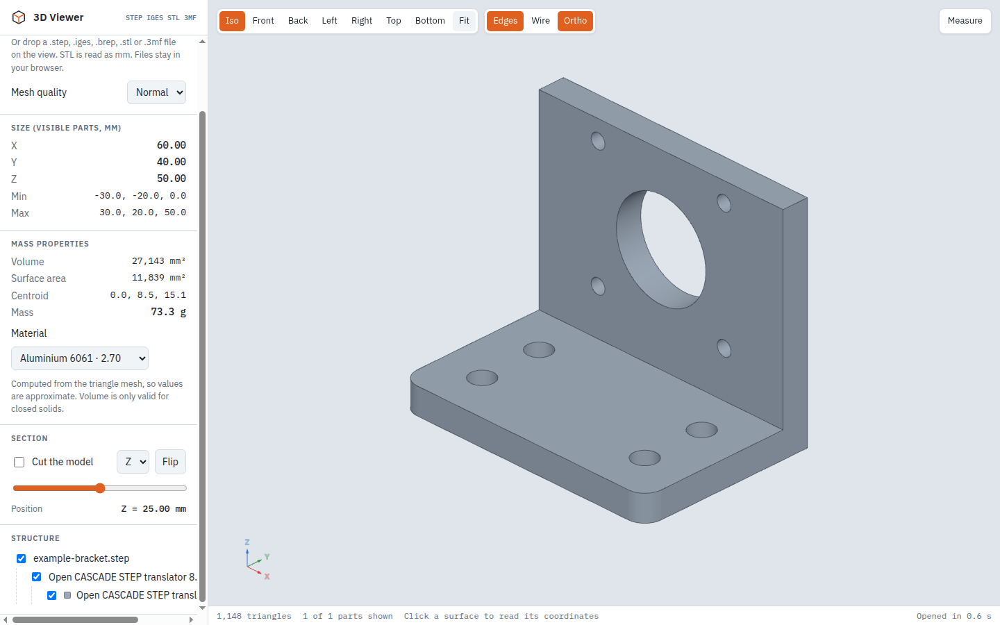
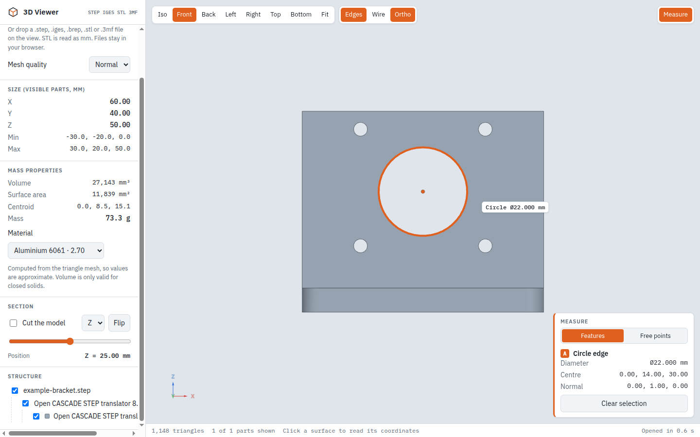

# 3D Viewer

A browser-based 3D viewer for CAD and mesh files. Open a model to inspect dimensions, measure features, cut a section, or estimate mass. Model files are processed in the browser and are not uploaded to a server.

## Screenshots

### Viewer overview



### Diameter measurement



## Features

- **File formats:** STEP (`.step`, `.stp`), IGES (`.iges`, `.igs`), BREP (`.brep`, `.brp`), STL (`.stl`), and 3MF (`.3mf`).
- **Model inspection:** Browse the part tree, toggle part visibility, and read the X, Y, and Z dimensions of visible parts in millimetres.
- **Measurements:** Pick points, edges, or faces to inspect distances, angles, edge lengths, radii, and diameters where applicable. Use **Free points** or hold `Shift` to pick a point without feature snapping.
- **Section views:** Cut along the X, Y, or Z axis, move the section plane, and flip the cut side.
- **Mass properties:** Estimate volume, surface area, centroid, and mass. Choose a material preset or enter a custom density.
- **Display controls:** Switch between orthographic and perspective views, toggle edges or wireframe, and fit the model to the viewport.

## Run locally

Use a browser with WebGL support. No package installation or build step is required. From the directory containing `index.html`, start a local HTTP server:

```sh
python3 -m http.server 8000
```

Open [http://localhost:8000](http://localhost:8000). The example bracket loads on startup; choose **Open file…** or drag a file onto the page to inspect your own model. Serve the folder over HTTP rather than double-clicking `index.html`, so the browser can load the modules, worker, and example file.

## Controls

| Control | Action |
| --- | --- |
| Left drag / right drag / scroll | Rotate / pan / zoom |
| `I` | Isometric view |
| `1`–`6` | Front, back, left, right, top, and bottom views |
| `F` | Fit model to view |
| `E` / `W` / `O` | Toggle edges / wireframe / projection |
| `M` / `Esc` | Toggle Measure / clear the measurement selection |

## Project layout

| File | Role |
| --- | --- |
| `index.html` | Viewer interface, rendering, and file-loading logic |
| `measure.js` | Feature picking and measurement tools |
| `worker.js` | Background parsing for STEP, IGES, and BREP |
| `occt-import-js.js` and `occt-import-js.wasm` | Open CASCADE importer and its WebAssembly binary |
| `three.module.min.js`, controls, loaders, and line modules | Three.js rendering, navigation, and mesh import |
| `fflate.module.js` | ZIP decompression for 3MF files |
| `example-bracket.txt` | Bundled STEP model; keep the `.txt` extension because the viewer requests this exact filename |

## Publish with GitHub Pages

Keep `index.html` and all bundled files, including `occt-import-js.wasm`, together in the repository root. After pushing to `main`, open your repository’s **Settings → Pages**, choose **Deploy from a branch**, select **main** and **/ (root)**, then save ([GitHub Pages setup](https://docs.github.com/en/pages/getting-started-with-github-pages/configuring-a-publishing-source-for-your-github-pages-site)).

## Measurement notes

Measurements and mass properties are derived from the rendered triangle mesh, so treat them as estimates rather than exact CAD values. Volume and mass estimates require closed solids, and STL files are interpreted as millimetres because STL does not store units.
